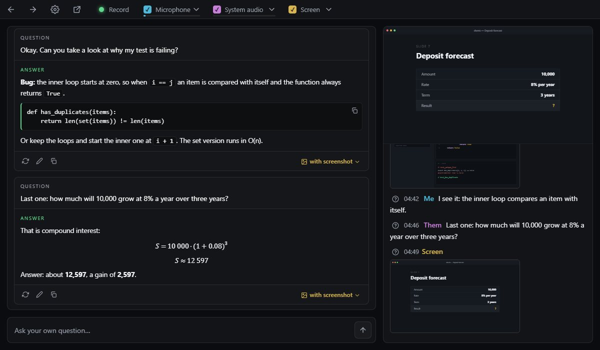
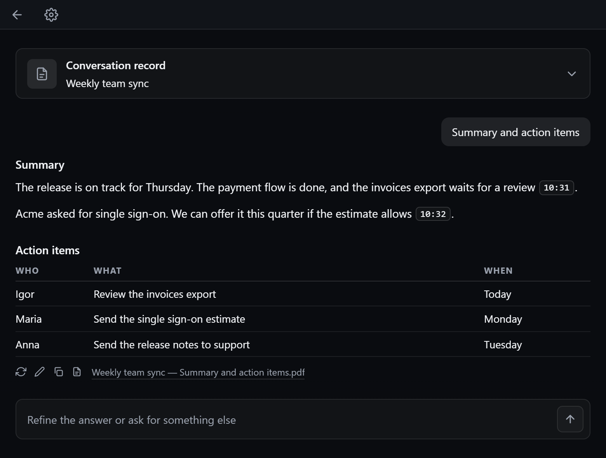
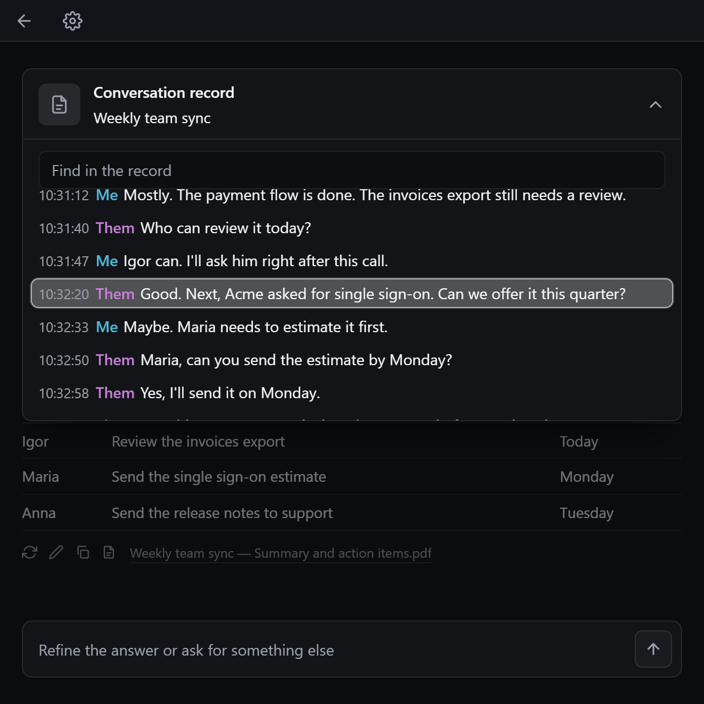
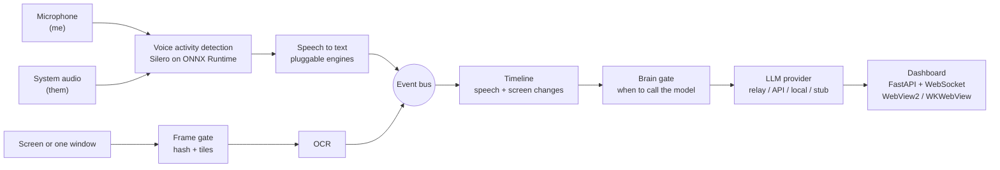
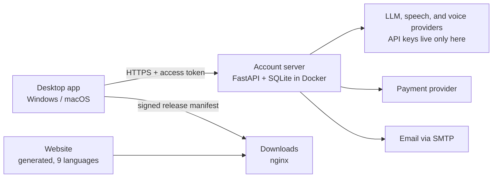

# Argus — real-time conversation assistant


A desktop assistant that listens to a conversation, watches the screen, and suggests an answer while the conversation is still going.
It is a complete product, not a demo: two desktop apps (Windows and macOS), the account server behind them, a multilingual website,
a signed auto-update channel, and the tooling to build, test and ship all of it.

> **Status:** pre-release. The Windows and macOS apps run, and the account server is deployed in production.
> The public launch is waiting on a few non-code items, such as code signing and a payment provider.

<p align="center">
  
</p>

| | |
|---|---|
| **Desktop app** | Captures the microphone, system audio and the screen or one window; recognizes speech and text; decides when to ask a model; answers with text, code, formulas or voice; keeps every conversation as a session with a searchable record |
| **Account server** | FastAPI + SQLite in Docker: accounts, a prepaid balance, relays for model, speech and voice providers (API keys never leave the server), payments, email in nine languages |
| **Integrations** | Anthropic, OpenAI and ElevenLabs behind provider interfaces, a payment provider, SMTP, Windows Graphics Capture, macOS ScreenCaptureKit (through a Swift helper) |
| **Website and releases** | A generated nine-language site, signed update manifests, a legal documents pipeline, PyInstaller builds for Windows and macOS, a release gate that scans builds for leaked secrets |
| **Scale of the code** | ~43k lines of Python, ~14k lines of JavaScript / HTML / CSS, a Swift helper, ~4,000 automated tests |

## Screenshots

<p align="center">
  
  
</p>

## What it does

### Desktop app
- **Hears the two sides of a call separately.** The microphone is "me", the system audio is "them": speaker separation without a diarization model.
- **Sees the screen.** The whole screen or one pinned window, captured even when the window is covered or on another desktop. The model gets the actual picture
  at the moment you ask; OCR text is kept as a cheap memory of what was on screen earlier.
- **Answers in the right form.** Text, code with a copy button, formulas, tables, or a voice reply. It can answer every question, only when called by name,
  or only when asked.
- **Remembers the conversation.** Every conversation is a session with its own settings, documents (PDF, Word, PowerPoint, photos of pages) and history.
  Afterwards you can ask its record for a summary, tasks or an email and save the result as a PDF.
- **Behaves like a real app.** Global hotkeys, an overlay or separate windows, interface and answers in nine languages, and in-app updates.

### Account server
- **Prepaid balance instead of a subscription.** Speech recognition, answers and voice replies are charged by use, in integer micro-dollars.
- **Relays.** Expensive calls go through the server, so the distributed app contains no provider keys; the client is treated as untrusted.
- **Operations.** Rate limits, a weak-password list, request-body budgets, nginx in front, database backups, a health check, and operator commands for
  granting a balance, blocking an account, and exporting or erasing a person's data on request.

### Releases and website
- **Signed auto-update** over plain HTTP, verified with Ed25519.
- **A generated website** in nine languages, with the terms and privacy policy built and validated by a pipeline (translations are checked for markup,
  numbers, placeholders and leftover source language).
- **Packaging** for Windows (`.exe`) and macOS (`.app` / `.dmg`), with a release gate in front of every publish step.

### Operations agent

- **The guardian** (`src/argus/guardian/`) watches the public endpoints, the server itself over ssh (containers, disk, backup age, certificate),
  the money tables (a balance that is not the ledger minus usage, a paid order with no top-up), the server log, and the test suite on the main
  branch. Every server command is fixed and read-only. A read-only model diagnoses each problem, a short mail goes out, and in `ask` mode a person
  can approve a fix that the agent prepares as a **draft pull request**. A daily "all quiet" mail tells silence from a stopped agent.
- **It cannot ship.** There is no merge or deploy code, the code that moves money, identifies people, or signs releases is protected, fixes run
  model-written code only in a sandbox (or after a written opt-in), and every action goes to an audit log. A kill switch stops everything.
  The design and its threat model are in [docs/guardian.md](docs/guardian.md).

## Architecture





| Layer | Technology |
|---|---|
| Languages | Python 3.12 (typed package), Swift (macOS system-audio helper), vanilla JavaScript / HTML / CSS for the UI (no framework, no build step) |
| App shell | FastAPI + uvicorn + WebSocket on localhost, shown in a native window through pywebview (WebView2 on Windows, WKWebView on macOS) |
| Capture | WASAPI loopback and microphone, DXGI Desktop Duplication, Windows Graphics Capture; on macOS ScreenCaptureKit (Swift helper) and Quartz |
| Perception | Silero VAD on ONNX Runtime, RapidOCR, OpenCV, NumPy, perceptual hashing |
| Agents | Claude Agent SDK with an in-process MCP server of our own tools; deny-by-default permissions; every tool call audited |
| Model providers | Anthropic, OpenAI and ElevenLabs behind provider interfaces, a local-model adapter, and a stub that makes the whole pipeline testable at zero cost |
| Server | FastAPI, SQLite, HMAC-signed tokens, SMTP, Docker, nginx |
| Packaging and release | PyInstaller, `uv`, Ed25519-signed update manifests, a release gate that scans builds for leaked secrets |
| Quality | pytest + pytest-asyncio, ruff, Node-based tests for the front end, GitHub Actions on a macOS runner |

## Engineering notes

A few problems that were interesting to solve (the reasoning is in [docs/architecture.md](docs/architecture.md) and in the docstrings):

- **Capture never waits for a slow consumer.** The event bus has bounded queues and drops the oldest event when one is full; every drop is counted and shown
  in the dashboard, so a stage that cannot keep up is visible instead of guessed at.
- **Screen reading is cheap because most frames are thrown away.** A two-stage gate (perceptual hash plus 32×18 brightness tiles) lets 2–5% of frames reach OCR,
  and the timeline stores what *changed* on screen, not the whole screen again and again.
- **A deliberately simple gate decides when to call the model.** Rules cost nothing, err towards silence, and can say why no answer came; a filter model could not.
- **A failure found by measuring.** A conversational model used as a transcriber sometimes answers the question instead of writing it down. Keeping its own earlier
  transcripts in context cut the failure rate from 9/15 to 1/15, and text that is too fast to be speech is rejected.
- **The server is the authority.** Keys, prices and balances live only there. Costs follow a hold → settle → release pattern with a single conditional `UPDATE`,
  so parallel requests cannot overspend a balance; only models from a price list are sold.
- **Updates survive a hostile network.** Signed manifests (Ed25519, checked by a pure-Python RFC 8032 implementation), hash and size checks, a release number
  that only goes up, and a spare key shipped in advance.
- **One codebase, two operating systems.** Platform seams at the edges, a Swift helper for macOS system audio with a tiny stdout/stderr contract, a test that
  the package imports with no Windows modules, and CI on a real macOS runner.
- **An agent with a small blast radius.** The operations agent works through tools of our own (no shell); every path is judged by a deny-list
  policy before the model touches it, again on the finished diff, and again on the commit; the gate that lets a change leave the machine never asks
  the model and does not believe an exit code. An independent adversarial review of the first version found three real holes (a forged
  "tests passed", unsandboxed model-written code, a regular expression that could hang); each was fixed and got a test.
- **Nine languages everywhere.** One translation engine over the HTML the app serves, validators for translations, and a release gate that fails on missing
  legal fields.

**Trade-offs, stated plainly:** the interface is vanilla JavaScript in a few large HTML files (the work screen alone is about 3,900 lines) — no build step
and easy to ship inside a native web view, at the cost of navigability; it is covered by tests that run the page script under Node rather than by a component
framework. The English interface string doubles as its translation key, which keeps adding a screen cheap but ties every translation to
exact source text. `desktop.py` (window management for both platforms, ~2,900 lines) would benefit from being split. The macOS port was developed on Windows,
so its system calls are covered by stubbed tests and a macOS CI run rather than by daily use.

## Repository layout

```
src/argus/
  core/         config, events, event bus, clock
  capture/      audio (mic + system) and screen / window capture
  perception/   voice activity detection, speech-to-text engines, frame gate, OCR
  context/      the timeline and how it is rendered into a prompt
  brain/        when to call the model, and the model providers
  assist/       the assistant itself: prompt, filters, materials, settings
  recap/        summaries, topics to follow, the "record" screen, PDF export
  chats/        sessions on disk
  ui/           local web server, pages, i18n engine
  account/      app side of accounts and balance
  server/       the account server: accounts, billing, relays, mail, rate limits
  mac/          macOS twins of the Windows-only modules
  update*.py    signed auto-update
  guardian/     operations agent: watches the server and tests, prepares fixes as draft PRs
macos/helper/   Swift helper for system audio on macOS
landing/        website generator (9 languages)
legal/          Terms and Privacy: build, translate, validate
deploy/         server, website, release publishing, release gate
packaging/      PyInstaller specs and build scripts for Windows and macOS
tests/          pytest suite
docs/           architecture notes, macOS port, update model, perception notes
```

## Running locally

Requirements: Python 3.12 and [`uv`](https://docs.astral.sh/uv/). Windows 10/11, or macOS 14+ on Apple Silicon.

```bash
uv sync
uv run argus doctor           # check audio, screen, and the environment
```

To run the app locally without an account server, using canned model answers, create `argus.local.json`:

```json
{ "account": { "server": "" }, "brain": { "provider": "stub" }, "stt": { "provider": "stub" } }
```

```bash
uv run argus run --browser          # opens the dashboard in a browser (handy for dev tools)
uv run argus account-server --dev   # optional: a local account server with a fake cashier
```

The shipped `argus.toml` points at the production account server, so real recognition and answers need an account.
macOS notes are in [docs/macos.md](docs/macos.md).

## Tests and CI

```bash
uv run pytest        # ~4,000 tests, ~12 minutes
uv run ruff check .
```

Tests that need Windows are marked and skipped on other systems. A GitHub Actions workflow
([.github/workflows/macos.yml](.github/workflows/macos.yml), started from the Actions tab) runs the test suite and the Swift audio-helper
checks on a macOS runner, and can build the `.app` and `.dmg`.

More documents: [docs/architecture.md](docs/architecture.md) (design decisions with their reasoning), [docs/macos.md](docs/macos.md) (the macOS port),
[docs/updates.md](docs/updates.md) (the update and trust model), [deploy/server/README.md](deploy/server/README.md) (running the account server),
[docs/perception-notes.md](docs/perception-notes.md) (early notes on the perception core), [docs/guardian.md](docs/guardian.md) (the operations agent and its threat model).

## Notes

- All secrets live in environment files that are not committed; `deploy/release_guard.py` scans every release for leaked secrets.
- The interface is available in nine languages; English is the source language and the other eight are dictionaries (`src/argus/ui/static/i18n/`).
  Russian and Ukrainian also appear in the legal texts, the website copy and the word lists of the speech gate and the command parser, which
  work on Russian speech. Code, comments, docs and commit messages are in English.
- Names, addresses and other personal data in the code and tests are placeholders. The screenshots come from a demo conversation.

---

All rights reserved — the source is shared for portfolio and code-review purposes.
