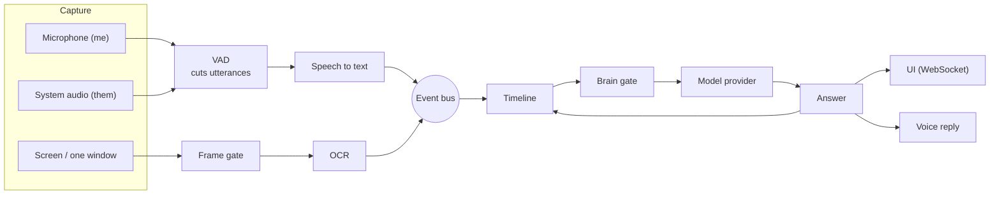

# Architecture and design decisions

This document explains how Argus is built and, more importantly, why. Most of it is distilled from the long
"why" comments at the top of the modules; the file to open is named in each section.

Argus has three parts that ship separately:

1. **The desktop app** (`src/argus/`, everything except `server/`). It captures audio and screen, turns them into text,
   decides when to ask a model, and shows the answer.
2. **The account server** (`src/argus/server/`). It owns accounts, the balance, prices, and all API keys.
   It is a separate program that never goes into the desktop build.
3. **The website and release tooling** (`landing/`, `legal/`, `deploy/`, `packaging/`).

The last arrow matters: the assistant's own answers go back into the timeline, so a follow-up such as "make it shorter" has something to refer to.

## 1. The event bus never blocks the producer

`core/bus.py` · tests: `test_bus_backpressure.py`, `test_event_loop_not_blocked.py`

Audio arrives on a thread owned by the operating system, with a hard deadline. If a callback waits for a slow consumer, the recording gets a hole.
So the bus has two rules:

- **Publishing never waits.** Queues are bounded, and when one is full the *oldest* event is dropped. Losing one frame is better than tearing the stream.
- **Losses are counted, not hidden.** Every subscription remembers how many events it dropped, and the dashboard shows the number.
  If it grows, some stage cannot keep up, and you see it immediately instead of guessing.

The bus is also what keeps the modules apart. Capture knows nothing about speech recognition, and recognition knows nothing about the timeline,
so a local engine can be swapped for a cloud one (or the other way round) without touching the rest.

## 2. Two audio streams: speaker separation for free

`capture/audio.py`, `capture/resample.py`, `perception/speech.py`

The microphone and the system audio are captured as **two independent streams**. The microphone is "me", the system audio is "them".
That replaces speaker diarization, which is hard and error-prone, with a fact the operating system already gives us.

Everything is normalized early to one format (16 kHz, mono, int16), so the later stages do not care where a sound came from.

Threading follows from what each stage costs:

- Voice activity detection runs directly in the event loop. It costs microseconds per window (about 227× faster than real time), so moving it elsewhere would only add handoffs.
- Recognition runs in worker threads. For a network engine there is **one worker per channel**: waiting for the network costs nothing locally,
  and a single shared queue would make the other person's question wait behind a long answer of mine.
- The loop only cuts audio into utterances and puts them in a per-channel queue. A separate consumer per channel waits for the transcript, so one slow utterance never stops the audio reading of both channels.

## 3. The screen is stored as changes, not as pictures

`perception/framegate.py`, `context/timeline.py`

A screen is mostly static. Menus, panels, and tabs do not change for hours, yet the driver reports a "change" for any pixel: a blinking cursor, a clock.
Two decisions follow.

**A two-stage frame gate before OCR.** OCR costs hundreds of milliseconds, so most frames must not reach it. The gate uses:

- a **difference hash** (dHash, 9×8 → 64 bits). It compares neighbouring brightness *relations*, so a backlight change or a soft background gradient does not trigger it;
- **brightness tiles** (a 32×18 grid). dHash is stable but coarse: measured on a 2560×1440 screen, one new line of text changes 0–1 of its 64 bits, below any sane threshold.
  A new line of code or chat does repaint three to six tiles, while a cursor or a clock digit repaints one or two. A shift that is the same across neighbouring tiles is ignored.

With both, 2–5% of frames reach OCR.

**The timeline stores the difference.** Measured on one live screen, a read every two seconds meant about 1,500 repeated lines per minute of identical text.
Putting that in a prompt means paying for the same words again and again, and burying the one line that matters: the new question or message.
So the timeline keeps what *appeared*; the full state of the screen is available separately when needed.

The model also gets the actual **screenshot** at the moment of asking (about +220 ms and ~1,000–1,500 tokens). OCR text is the memory of what was on screen earlier.

A pinned window is captured through Windows Graphics Capture rather than cropped from a screenshot. So it still reads when another window covers it or it sits on another desktop.
This was measured: on a browser playing a stream, the centre of the window had 0% non-empty pixels through `PrintWindow` and 99% through Graphics Capture.

## 4. Deciding when to wake the model: with rules, on purpose

`brain/gate.py`, `assist/gate.py`

Calling a model on every utterance is slow and expensive. Between the timeline and the model sits a layer that costs microseconds and drops most triggers.
It is deliberately built on **rules, not on another model**:

- The costs are asymmetric. A check costs nothing; a wrong wake-up costs money, seconds of latency, and a share of the rate limit.
  Rules that err towards silence beat a clever filter that errs both ways and costs time itself.
- Debuggability. When no answer comes, you must see why at once. A rule can answer with a line of text; a filter model cannot.

Triggers are explicit (a hotkey, a question from the other side, something new on the screen), each with a cool-down so a run of question-shaped lines does not become a run of calls.

Model providers share one interface (`brain/base.py`): the account-server relay (the shipped default), direct Anthropic and OpenAI APIs, a local OpenAI-compatible model, and a **stub** that returns canned answers.
The stub means the whole pipeline can be exercised, and tested, with no network and no bill. A subscription-based provider exists as a development convenience only.

## 5. A failure mode found by measuring: the transcriber answers instead of transcribing

`perception/stt/`, `docs/perception-notes.md`

Measured on the live API: a conversational model used as a transcriber occasionally **answers the question it heard instead of writing it down**.
Worse, the failure sustains itself: the answer lands in the session history, and from then on the model keeps having a dialogue instead of transcribing.

Two things in the code come from that measurement:

- **The model's own earlier transcripts are kept in the history.** Removing them looked cleaner but made things worse: the failure rate rose from 1 in 15 to 9 in 15.
  The model keeps its role when it sees its own previous outputs; they act as examples.
- **Text that is too fast to be speech is rejected.** Speech runs at 1.3–2.0 words per second, answers at 2.75–9.25. The `max_words_per_second` threshold sits between them.
  A dropped utterance shows up as "not recognized". A silently accepted answer would pass as a disagreement between two engines, and the comparison would lie.

The same measurement setup runs two engines side by side on the *same* audio segment (cut by our own VAD, so both see identical boundaries).
The second engine never affects the first: its text does not enter the timeline, the prompt, or any filter, and it runs in its own thread.
Otherwise turning on the measurement would change what is being measured. The one exception is a rescue: if the primary engine produced nothing, the second one's text is used, and the utterance is marked `rescued_by`.

## 6. The server decides, the client is untrusted

`server/entitlements.py`, `server/relay.py`, `server/pricing.py`, `server/relay_stt.py`

The app runs on someone else's computer, and any check inside it can be removed in ten minutes.
So everything about money and access is computed on the server, and the one thing that cannot be removed is the server refusing to hand over an answer.

- **Keys never leave the server.** Expensive calls (model answers, speech recognition, voice synthesis) go through relays. The distributed build contains no provider keys.
- **Hold → settle → release.** A long call is paid after it happens, but a worst-case cost is first *held*: subtracted from the balance by a single conditional `UPDATE`,
  so parallel requests on the same balance see the reduced amount and cannot overspend it. After the call the real price is taken and the difference returned; on provider failure everything is returned.
  The streaming speech socket applies the same idea per minute of audio.
- **An allowlist of models.** The client sends a model name, so without a list anyone could ask for the most expensive one. Only models in the price list (`pricing.MODELS`) are sold.
- **Integer micro-dollars.** Costs per answer are fractions of a cent, and floating-point money drifts over a thousand calls. Integers do not.
- **Prices are tested.** The markup (×2) exists to cover payment fees and price drift; `test_the_smallest_top_up_stays_profitable` fails if someone changes the number without rechecking the smallest top-up.
- **Billing providers plug in as one class** (`billing.py`), with a sandbox account allowlist so test payments cannot credit real balances.

Other hardening: HMAC-signed tokens (15-minute access, 90-day refresh), attempt counters per email, address, and account (`throttle.py`),
a weak-password list, request-body budgets, nginx in front with HSTS and frame protection, and operator commands for granting a balance, blocking an account,
and exporting or erasing a person's data on request. Email goes out through plain SMTP, in the user's language.

## 7. Updates that survive a hostile network

`update.py`, `update_trust.py`, `ed25519.py`, `deploy/release_guard.py` · details: `docs/updates.md`

The app updates itself from a plain `http://` address, where a man-in-the-middle cannot be told apart from the real file. So trust does not come from the transport:

1. The release manifest (`latest.json` / `latest-mac.json`) is **signed with Ed25519**. The public keys are built into the app; a spare key is shipped in advance, so losing the main one does not strand installed apps.
2. The signed string covers platform, version, archive name, SHA-256, size, and a **release number**. Changing any field breaks the signature; a Windows build cannot pass for a Mac build.
3. The downloaded archive must match the signed hash and size before anything is unpacked.
4. The release number only goes up, so an old but validly signed release cannot be replayed as an update.
5. On macOS the package must also pass `codesign --verify` and keep the same bundle identifier.

Signature checking is a **pure-Python Ed25519 (RFC 8032)** in `ed25519.py`, tested against the RFC vectors and against the `cryptography` library, so the build gets no new dependency.

On the publishing side, every release step (Windows build, macOS build, website) passes **one shared gate** (`release_guard.py`):
real secret values from `.env` are searched byte by byte, key-shaped strings are searched in text and, with a narrower pattern, in binaries and inside PyInstaller's compressed archive,
and legal pages with unfilled placeholders are refused.

## 8. One codebase, two operating systems

`src/argus/mac/`, `macos/helper/`, `docs/macos.md`

The shared code knows nothing about the platform. Windows modules stayed where they were; macOS gets twins under `src/argus/mac/`, called lazily and only on macOS through early `if sys.platform == "darwin"` seams.

- `tests/test_portability.py` guards the seam. In a clean interpreter it blocks the Windows-only packages, then pretends to be `darwin` with `ctypes.windll` removed, and imports the package again.
- **System audio** on macOS has no loopback API. The only way without a driver is ScreenCaptureKit, and building audio buffers from `CMSampleBuffer` through PyObjC means pointers where a mistake does not crash but corrupts sound.
  So it is a small Swift helper (`argus-syscap`, about 350 lines), and Python only starts it. The contract is tiny: raw int16 PCM on stdout, JSON lines on stderr, closing stdin means "the parent died, exit", and flags for including or excluding processes.
  `tests/test_mac_helper_contract.py` reads both the Swift and the Python source and checks that they agree on arguments, exit codes, events, and audio format.
- **Data location.** A signed `.app` breaks if anything is written inside it, so user data lives in `~/Library/Application Support/Argus`, and the bundle carries seed files that are laid out on first start.
- **Verification.** Development happens on Windows, so tests that need Windows are marked `windows_only`, and the real macOS behaviour is checked in CI on a macOS runner, which also builds the `.app` and `.dmg`.

## 9. Nine languages and a legal pipeline

`src/argus/ui/i18n.py`, `i18n/`, `legal/`, `landing/`

- **App interface.** The pages are written in one language. For the others, the server injects a dictionary and a small script (`static/i18n/engine.js`) into every HTML response.
  It is one layer over all responses, not a call in each route, because pages get added and changed often and a per-route call would eventually be forgotten.
- **Website.** `landing/` generates a static site in nine languages from a template, per-language copy, and screenshots rendered from scenarios.
- **Legal texts.** The English Terms and Privacy Policy are the source of truth. Translations pass a validator (markup, numbers, placeholders, leftover English, expected script),
  and `legal/build.py --release` fails when operator fields are empty, so a page with gaps cannot ship.
- **Email.** Account emails and the password-reset page exist in nine languages, with their own validator (`tools/validate_mail_texts.py`).

## 10. How it is tested

About 4,000 test cases in 170+ files; the stub providers keep almost all of them offline and free.

- **Behaviour of the pipeline:** back-pressure on the bus, the event loop staying unblocked, the frame gate, VAD, OCR, and the model gate.
- **The server:** auth hardening, billing and holds, relays, rate limits, mail, and deployment (for example, pinned dependencies in the Docker image must match `uv.lock`).
- **The front end:** pages are exercised under Node with a DOM, so UI logic has tests without a browser.
- **Contracts and guards:** the macOS helper contract, package portability, a scan that user-visible text never leaks internals (provider names, tokens), and checks on translations.
