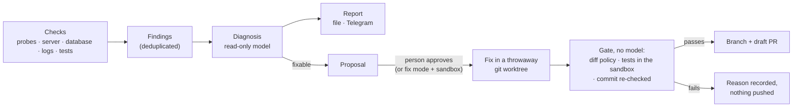

# The guardian: an operations agent that prepares fixes but never ships them

`src/argus/guardian/` watches the project and the server, asks a model to diagnose what it finds, and can prepare a fix as a
**draft pull request**. It cannot merge, deploy, or touch the code that moves money, identifies people, or signs releases. A person
always has the last word.

It is deliberately *not* part of the desktop app: it has its own entry point (`python -m argus.guardian`), nothing in `argus.cli`
imports it, and a test checks that.

## Modes

| Mode | What runs | Who decides |
|---|---|---|
| `off` | nothing | |
| `watch` | checks, a read-only diagnosis, a report. **No model-written code is ever run.** | nobody needs to |
| `ask` (default) | as `watch`, plus a fix **proposal** for problems the model marked fixable | a person runs `approve <id>` |
| `fix` | as `ask`, but the fix is prepared without waiting | the policy gate and the tests. **Requires a sandbox**; without one the guardian runs as `ask` |

Preparing a fix means running the tests, and running the tests means running code the model wrote. So any fix, in any mode,
needs either a `sandbox` (see below) or an explicit `allow_unsandboxed = true` from the person who accepts that risk. Without one
the guardian still diagnoses and reports; it just does not propose fixes.

A file named `OFF` in the guardian's home folder, or `GUARDIAN_OFF=1`, stops everything immediately, whatever the mode.

## What it watches

| Check | Looks at | A problem is |
|---|---|---|
| `probes` | HTTP addresses (the API, the download manifest) | an address that fails twice in a row, or answers without the expected text |
| `host` | the server itself, over ssh: containers (running, healthy), disk, age of the newest database backup, days left on the certificate | a container that is down or unhealthy, a disk over 90%, a backup older than 36 hours, a certificate with under 14 days left, or a server that cannot be reached (all after two checks in a row) |
| `data` | the accounts database, through a read-only connection inside the server container | a negative balance; a balance that is not the ledger minus usage minus holds; a hold older than 15 minutes; a paid order with no top-up in the ledger; a charge below its cost |
| `logs` | the server log (a file, or a command such as `ssh host docker logs --since {since} argus-server`) | one Python traceback, named by its exception and innermost frame, a repeated `ERROR` line, or a repeated `5xx` answer in the access log (method, path, and status only, never the caller's address); the same bug is one problem however often it happens |
| `repo_tests` | the test suite, run on a clean copy of the main branch whenever it moves (or daily) | one failing test |

Each problem is a *finding* with a stable key, so a bug that fires a thousand times is one row, one diagnosis, and one message. A
finding disappears from the list on its own when its check stops seeing it.

### How the server is read

The `host` and `data` checks reach the server with `ssh_command` (an ssh prefix, for example a key that is allowed to run commands). They
send only commands that are built in the code from constants and from names checked when the settings load (letters, digits, `_ . - /`;
anything else is refused). Nothing a log, a model, or a database row says ever becomes part of a command. The commands only read:
`docker inspect`, `df`, `ls`, `stat`, `openssl x509 -enddate`, and one Python script that opens SQLite with `mode=ro` and runs `SELECT`s
(a test fails if the script ever contains a write keyword). The database report holds counts and account *numbers*, never e-mail
addresses or amounts per person. If the server cannot be reached, that is one finding, and no other problem is declared fixed while the
guardian is blind.

For least privilege, give the ssh key a dedicated account that is in the `docker` group, or restrict the key to those commands on the
server side; the guardian does not need to write anything there.

## From problem to pull request



The model works with a few tools of our own (`read_file`, `search_code`, `edit_file`, `run_tests`, …) and has no shell. The gate that
decides whether a change may leave the machine is code that never asks the model anything: it reads the diff from `git`, runs the
tests, and then checks the *commit* a second time.

## The threat model

The model is assumed to be fallible or manipulated: logs contain text from strangers (an e-mail address, a query string, an
error message), and anything that reaches the model can try to give it orders.

| Threat | Control | Where it is tested |
|---|---|---|
| Injected instructions in a log or a test failure | evidence is redacted, wrapped in `<untrusted-data>`, and the prompt says it is data; **even if the model obeys, the tools below refuse** | `test_a_manipulated_model_gets_nowhere` |
| The model reads a secret | `READ_DENY` (keys, `.env`, databases, tokens, chats); every path is normalised, refused if absolute / `..` / NTFS stream / 8.3 name / reserved device name, and judged again after links are resolved; file content is redacted on the way out | `test_guardian_safety.py` |
| The model changes the billing, accounts, tokens, update, signing, deploy, or CI code, or the guardian itself | `WRITE_DENY` on every write, and again on the finished diff and on the commit | `test_the_gate_stops_changes_the_tools_alone_would_allow` |
| Code that runs by itself when Python or pytest starts (`sitecustomize.py`, `conftest.py`, `*.pth`, `pytest.ini`, …) | those names cannot be written | `test_files_that_python_and_pytest_run_implicitly_cannot_be_written` |
| A "fix" that deletes or weakens a test | existing test lines may only be added to; added `skip`/`xfail` markers, new binaries, deletions, and renames are refused; a fix for a runtime problem must come with a test | the same |
| A huge or sprawling change | at most 6 files and 250 changed lines | the same |
| The model starts a process, reaches the network, exits early, or tampers with the interpreter | there is no tool that can; code it adds may not contain `subprocess`, sockets, `os._exit`, `sys.exit`, `eval`, `importlib`, … (in tests or in source) | `test_code_that_starts_processes_exits_early_or_tampers_with_python_is_refused_anywhere` |
| A run that "passes" by dying early | the exit code is not believed: pytest must write its own JUnit report with at least one test, no failures, no errors | `test_an_exit_code_alone_is_not_believed_when_the_command_is_pytest` |
| The test run changes what gets committed | the finished commit is judged again against the same policy, and must sit directly on the base | `test_a_commit_that_differs_from_the_approved_change_is_never_pushed` |
| Model-written code runs on the developer's machine | a fix needs a `sandbox` or a written opt-in; `fix` mode needs a sandbox; the launcher gets nothing pointing into the worktree; test processes get a scrubbed environment (no tokens, no API keys) | `test_a_fix_is_not_attempted_without_a_sandbox_unless_that_risk_is_accepted_in_writing`, `test_test_processes_do_not_inherit_tokens` |
| A regular expression that never finishes | search is a literal substring match; it never follows a link out of the worktree | `test_search_is_literal_so_no_pattern_can_hang` |
| Git as a hiding place (hooks, external diff, file-system monitor) | every git call disables them and points `core.hooksPath` at an empty folder | |
| Something is pushed, merged, or deployed | only a `guardian/*` branch is ever pushed (never forced), the pull request is a *draft*, and there is no merge or deploy code at all | `test_there_is_no_way_to_merge` |
| Runaway cost or work | per-run and per-day caps on money (API mode) and tokens (also on a subscription), daily limits on diagnoses and fixes, cooldowns, an atomic lock against overlapping cycles | `test_daily_limits_hold`, `test_the_token_cap_stops_further_model_calls_even_on_a_subscription` |
| No trace of what happened | an append-only, redacted audit log: every tool call (blocked ones too), every state change, every external action | `test_the_audit_log_redacts_what_it_records` |

### What is not covered, stated plainly

* A model-written test is code, and running it runs code. The static checks above are a seatbelt, not a boundary; the boundary is the
  sandbox. This is why no fix is attempted without one (or a written opt-in).
* Even in a sandbox, the result of a test run that executed model-written code is the guardian's own evidence, not proof: the code could
  have forged it. The pull request says so, and the project's CI is the authority. A person reads the pull request.
* Redaction is pattern-based. It catches the common shapes of secrets, not every one.
* The guardian proposes; it does not judge whether a fix is *right*.

A review by an independent attacker found three real holes in an earlier version (a forged "tests passed", unsandboxed execution of
model code, and a regular expression that could hang). They are fixed and each has a test; the notes above are the result.

## Setting it up

1. Make a **separate clone** of the repository for the guardian (it only fetches there and adds throwaway worktrees).
2. Create `~/.argus/guardian/guardian.toml`:

   ```toml
   mode = "ask"
   repo = "D:/guardian-checkout/argus"
   base_branch = "master"
   github_repo = "OWNER/argus"
   ssh_command = ["ssh", "-i", "/home/me/.ssh/guardian_key", "-o", "BatchMode=yes", "-o", "ConnectTimeout=15", "guardian@argus-server"]
   log_command = ["ssh", "-i", "/home/me/.ssh/guardian_key", "-o", "BatchMode=yes", "guardian@argus-server",
                  "docker logs --since {since} argus-server 2>&1"]
   host_containers = ["argus-server", "argus-discord"]
   host_backup_dir = "/opt/argus-server/backups"
   host_cert = "/opt/argus-server/certs/live/example.com/fullchain.pem"
   data_container = "argus-server"
   heartbeat_hour = 9           # one short "all quiet" mail a day, from 09:00 local time

   [[probes]]
   name = "api"
   url = "https://api.example.com/pricing"

   [[probes]]
   name = "downloads"
   url = "https://example.com/latest.json"
   expect_text = "version"
   ```

3. Secrets come from the environment (or a one-line file), never from `guardian.toml`: `GUARDIAN_GITHUB_TOKEN` (to open draft pull
   requests; without it the branch is pushed and a compare link is reported). For the model, `auth = "subscription"` uses a logged-in
   Claude Code (development) and `auth = "api"` uses `ANTHROPIC_API_KEY`.
4. Choose how you are told (a report file is always written to `reports/`; `test-notify` checks every channel):
   * **E-mail**: set `email_from` and `email_to` in `guardian.toml`, and give the sending key in `GUARDIAN_RESEND_KEY` or in the one-line file
     `resend_key_file` (default `~/.argus/resend_api_key`). Mail goes through the Resend service. Pointing `email_to` at an address that
     forwards to a person keeps their own address out of the settings.
   * **Telegram**: `GUARDIAN_TELEGRAM_TOKEN` and `GUARDIAN_TELEGRAM_CHAT`.
   One message is sent per cycle (not one per problem), reminders for critical problems come every 6 hours, and everything is redacted.
   With `heartbeat_hour` set, a quiet day still gets one short mail ("all quiet", what was looked at, what is still open), so that
   silence can be told from a guardian that has stopped. A problem report counts as that day's mail.
5. Run it:

   ```bash
   python -m argus.guardian status
   python -m argus.guardian run-once            # what a scheduler should call; --dry-run pushes nothing
   python -m argus.guardian show F-3bf2d9       # the diagnosis and the evidence
   python -m argus.guardian approve F-3bf2d9    # allow a fix; --now runs it at once
   python -m argus.guardian reject F-3bf2d9
   python -m argus.guardian off                 # the kill switch
   python -m argus.guardian test-notify         # send a test message through every channel
   ```

   Schedule `run-once` every 15 minutes with Task Scheduler, cron, or a systemd timer.

6. To allow fixes, set `sandbox` to a command prefix that runs the tests where the code cannot hurt anything and, if the test command
   differs inside it, `sandbox_test_command`. The sandbox sets up its own import path and environment on the inside. For example, a
   container with no network:

   ```toml
   sandbox = ["docker", "run", "--rm", "--network", "none", "-e", "PYTHONPATH=/w/src", "-v", "{worktree}:/w", "-w", "/w", "python:3.12", "--"]
   sandbox_test_command = ["python", "-m", "pytest", "-q"]
   ```

   (The sandbox must be able to run the project's tests; Argus' Windows-only tests need a Windows sandbox.) Without a sandbox, a person
   may write `allow_unsandboxed = true` to accept that approved fixes run with their own permissions.

## When the model is unavailable

If a run ends in a usage limit, a billing or login error, the cycle records the time to try again, stops diagnosing, and leaves the
remaining problems undiagnosed instead of failing each of them in turn. Nothing else is affected: probes, log scans, and test runs
need no model. The report says "did not submit a diagnosis" or names the error.

## Limits you can change

`budget_per_run_usd`, `budget_per_day_usd`, `max_tokens_per_day`, `max_diagnoses_per_day`, `max_fixes_per_day`, `diagnose_cooldown_h`,
`notify_cooldown_h`, `max_files`, `max_changed_lines`, `tests_every_h`: see `config.py`.

## Tests

`tests/test_guardian_*.py` (about 200 tests). The model is the only thing replaced: the git repository, worktrees, policy, diff gate,
test run, commit, and push to a local remote are all real. `tests/test_guardian_safety.py` is the one to read first. A live run with the
real model on a throwaway repository (diagnosis, proposal, approval, fix, draft pull request) was done by hand and took about half a minute.
